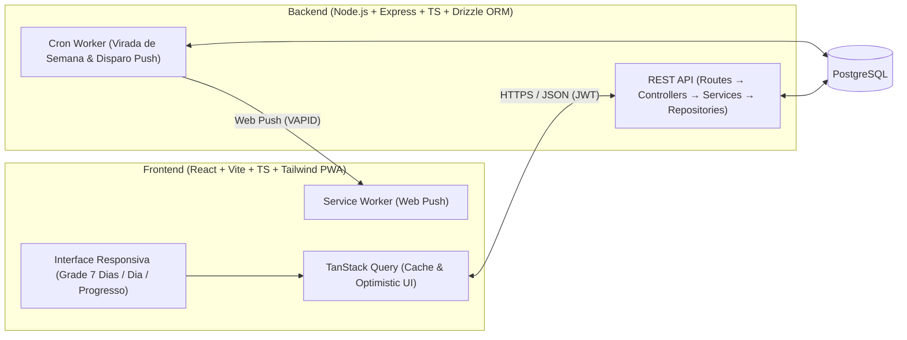

# Design & Especificação — App de Gerenciamento de Rotina Semanal

> Documento gerado e validado através do processo estruturado de **Brainstorming**.

---

## 1. Resumo do Entendimento (Understanding Summary)

- **O que está sendo construído:** Um **Web App Responsivo / PWA** para gerenciamento de rotina semanal e tarefas, acessível no computador e no celular, com sincronização em nuvem e autenticação de usuários.
- **Por que existe:** Para ajudar o usuário a estruturar sua semana com clareza, flexibilidade e organização por horários, acompanhando sua consistência sem perder o controle de tarefas pendentes quando uma semana termina.
- **Para quem é:** Usuários individuais que buscam organizar horários fixos, hábitos recorrentes e tarefas pontuais em uma interface simples, rápida, confiável e privada.
- **Regra Central — Rotina Recorrente vs. Tarefas Atrasadas:**
  - **Atividades Recorrentes (Rotina/Hábitos):** Repetem-se semanalmente nos dias/horários configurados. Se não forem concluídas até o fim da semana, expiram automaticamente como **"Não realizadas" (`NOT_DONE`)** no histórico daquela semana, e a nova semana inicia limpa com novas ocorrências.
  - **Tarefas Pontuais:** Se não forem concluídas no prazo/semana, **não desaparecem**; entram em uma fila/bandeja destacada de **Tarefas Atrasadas (`OVERDUE`)**, onde o usuário deve decidir explicitamente se deseja **Reagendá-las** (para uma nova data/horário), **Marcá-las como Não Realizadas** (`NOT_DONE`) ou **Concluí-las** (`COMPLETED`).
- **Organização, Progresso e Personalização:**
  - Modelo híbrido de horários: atividades/tarefas podem ter horário específico (`09:00–10:00`) ou ficar alocadas *"No dia (sem hora fixa)"*, com **Visão de Grade Semanal (7 dias)** e **Visão do Dia/Agenda**.
  - **Lembretes:** Notificações Push no navegador/celular (Web Notifications / PWA) antes do horário agendado.
  - **Progresso e Personalização:** Categorias/Tags com cores personalizadas, Tema Claro/Escuro, barra de progresso diária/semanal (`% de conclusão` e resumo de concluídas vs. não realizadas vs. reagendadas), *streaks* (sequências de consistência) e gráficos históricos por categoria.
- **Não-Objetivos Explícitos (Non-Goals para o MVP):**
  - Colaboração multiusuário / compartilhamento de tarefas em equipe.
  - Integrações externas complexas (sincronização bidirecional com Google Calendar, WhatsApp ou disparo de e-mails).
  - Apps nativos nas lojas (App Store / Google Play), priorizando Web Responsivo / PWA.

---

## 2. Requisitos Não-Funcionais e Premissas (Assumptions)

1. **Performance:** Carregamento inicial rápido (< 2s) e marcação de tarefas/atividades instantânea na interface (< 100ms via *Optimistic UI*).
2. **Escala:** Dimensionado inicialmente para uso individual a alguns milhares de usuários ativos, com centenas de registros de tarefas e execuções semanais por usuário ao ano.
3. **Segurança e Privacidade:** Isolamento total de dados por usuário (`userId`) em todas as consultas da API, senhas criptografadas com `bcrypt` e autenticação via JWT.
4. **Confiabilidade e Disponibilidade:** Persistência em banco PostgreSQL; a virada de semana é determinística e idempotente (executada por Cron Worker no backend + verificação automática no carregamento da semana), respeitando o fuso horário do usuário.
5. **Manutenção:** Código 100% tipado em TypeScript tanto no Frontend quanto no Backend, facilitando evolução e manutenção.

---

## 3. Registro de Decisões (Decision Log)

| # | Decisão | Alternativas Consideradas | Motivo da Escolha |
|---|---------|---------------------------|-------------------|
| 1 | **Plataforma:** Web App Responsivo / PWA | App Mobile Nativo; App Desktop Local (Electron/Tauri); Web apenas Desktop | Permite acesso contínuo no PC e no celular com instalação via navegador e suporte a notificações Web Push sem custo de lojas. |
| 2 | **Persistência e Privacidade:** Nuvem Multi-dispositivo com Autenticação | Apenas Local (LocalStorage/IndexedDB); Self-hosted restrito | Garante que o usuário acesse e sincronize sua rotina tanto no computador quanto no smartphone com segurança. |
| 3 | **Comportamento na Virada de Semana:** Apenas Tarefas Pontuais acumulam como Atrasadas; Rotinas Recorrentes expiram como *Não Realizadas* | Acumular tanto rotinas quanto tarefas na fila de atrasadas; Rotinas apenas visuais sem check | Evita acumular dezenas de hábitos repetidos de semanas passadas (ex: "Academia de sexta passada"), mantendo a cobrança de decisão focada nas tarefas pontuais pendentes. |
| 4 | **Organização de Horários:** Modelo Híbrido (Horário fixo + "No dia sem hora fixa") com Grade Semanal e Visão Diária | Grade estrita obrigando hora em tudo; Apenas divisão por turnos (Manhã/Tarde/Noite) | Equilibra a precisão de compromissos com hora marcada e a flexibilidade de tarefas que só precisam ser feitas ao longo do dia. |
| 5 | **Lembretes:** Web Push Notifications / PWA | Apenas alertas in-app; E-mail; Bots de WhatsApp/Telegram | Entrega notificações diretamente no sistema operacional/celular mesmo com a aba em segundo plano, sem custos de APIs de terceiros. |
| 6 | **Arquitetura Técnica:** Opção 3 — Frontend React + Backend Node.js/API próprio + PostgreSQL + Cron Worker | Opção 1 (Next.js + Supabase BaaS); Opção 2 (React + Firebase NoSQL) | Controle total sobre as regras de negócio no servidor, modelagem relacional forte no PostgreSQL para relatórios/streaks e worker dedicado para virada de semana e disparo de Web Push. |

---

## 4. Design Final Detalhado

### 4.1. Arquitetura do Sistema

Estrutura dividida em dois módulos principais (`frontend/` e `backend/`):

### 4.2. Modelo de Dados (PostgreSQL / Drizzle ORM Schema)

- **`users` (`User`)**
  - `id` (UUID, PK), `name`, `email` (Unique), `passwordHash`
  - `timezone` (default: `"America/Sao_Paulo"`), `theme` (`"LIGHT"` | `"DARK"`), `weekStartsOn` (`0` = Dom, `1` = Seg)
  - `createdAt`, `updatedAt`
- **`categories` (`Category`)**
  - `id` (UUID, PK), `userId` (FK), `name`, `colorHex` (ex: `"#3B82F6"`), `icon` (opcional)
- **`routine_activities` (`RoutineActivity` - Template de Atividade Recorrente)**
  - `id` (UUID, PK), `userId` (FK), `categoryId` (FK opcional)
  - `title`, `description` (opcional)
  - `daysOfWeek` (`Int[]` — ex: `[1, 3, 5]` para Seg, Qua, Sex)
  - `startTime` (`"07:00"`, opcional), `endTime` (`"08:00"`, opcional)
  - `reminderMinutesBefore` (`Int` opcional, ex: `15`)
  - `currentStreak` (`Int`, default `0`), `bestStreak` (`Int`, default `0`)
  - `active` (`Boolean`, default `true`)
- **`routine_executions` (`RoutineExecution` - Ocorrência Semanal Materializada)**
  - `id` (UUID, PK), `routineId` (FK), `userId` (FK)
  - `weekStartDate` (`Date`), `scheduledDate` (`Date`)
  - `status` (`PENDING` | `COMPLETED` | `NOT_DONE`)
  - `completedAt` (`DateTime` opcional), `reminderSent` (`Boolean`, default `false`)
- **`tasks` (`Task` - Tarefa Pontual)**
  - `id` (UUID, PK), `userId` (FK), `categoryId` (FK opcional)
  - `title`, `description` (opcional)
  - `scheduledDate` (`Date`), `startTime` (opcional), `endTime` (opcional)
  - `priority` (`LOW` | `MEDIUM` | `HIGH`, default `MEDIUM`)
  - `status` (`PENDING` | `OVERDUE` | `COMPLETED` | `NOT_DONE`)
  - `rescheduledCount` (`Int`, default `0`), `originalScheduledDate` (`Date`)
  - `reminderMinutesBefore` (`Int` opcional), `reminderSent` (`Boolean`, default `false`)
  - `completedAt` (`DateTime` opcional)
- **`push_subscriptions` (`PushSubscription`)**
  - `id` (UUID, PK), `userId` (FK), `endpoint`, `p256dh`, `auth`, `createdAt`

---

### 4.3. Componentes de Interface (Frontend)

1. **Barra Superior (`AppHeader`):**
   - Navegador de semanas (Semana Anterior / Semana Atual / Próxima Semana).
   - Barra de progresso rápido da semana (`% concluído`).
   - Indicador de *Streak* geral, botão de Tema Claro/Escuro e menu do usuário.
2. **Bandeja de Tarefas Atrasadas (`OverdueTray`):**
   - Alerta persistente exibido sempre que existirem tarefas pontuais com status `OVERDUE`.
   - Permite ação individual ou rápida para cada tarefa atrasada:
     - **Reagendar:** Escolhe nova data/horário → status volta a `PENDING`, `scheduledDate` atualizada, `rescheduledCount + 1`, `reminderSent = false`.
     - **Marcar como Não Realizada:** Status muda para `NOT_DONE` (sai da lista de pendências, mas permanece registrada no histórico).
     - **Concluir:** Status muda para `COMPLETED`.
3. **Planejador Semanal Híbrido (`WeeklyPlanner` & `DayAgenda`):**
   - **Visão de 7 colunas** no Desktop e **Visão por Dia (com seletor rápido de dia da semana)** no Mobile.
   - Em cada dia:
     - Seção superior compacta para itens **"No dia (sem horário fixo)"**.
     - Linha do tempo ordenada por `startTime` exibindo atividades recorrentes (`🔁`) e tarefas pontuais (`📌`) estilizadas com a cor de sua `Category`.
4. **Painel de Progresso e Estatísticas (`ProgressDashboard`):**
   - Resumo de métricas da semana: Total Planejado, `% Concluído`, Concluídas, Não Realizadas e Reagendadas.
   - Gráfico de desempenho por Categoria (`Category`).
   - Cards de *Streaks* das atividades recorrentes (`currentStreak` vs. `bestStreak`).
5. **Modais de CRUD e Personalização:**
   - Modal unificado e intuitivo para criar/editar Tarefa Pontual ou Atividade Recorrente.
   - Gerenciador de Categorias/Tags com paleta de cores.

---

### 4.4. Fluxo de Dados e Regras da Virada de Semana

A função de reconciliação (`reconcileUserSchedule(userId)`) é **idempotente** e roda tanto no **Cron Worker** quanto ao consultar a semana atual (`GET /api/schedule/week`):

1. **Expiração de Rotinas Recorrentes:**
   - Todas as `RoutineExecution` com `scheduledDate` pertencente a semanas já encerradas e `status == PENDING` são atualizadas para `NOT_DONE`.
   - Atualiza os contadores de `currentStreak` e `bestStreak` da `RoutineActivity`.
2. **Detecção de Tarefas Atrasadas:**
   - Todas as `Task` pontuais com `scheduledDate < hoje` (ou de semanas encerradas) e `status == PENDING` são atualizadas para `OVERDUE`.
   - Elas **nunca são apagadas ou ocultadas** na troca de semana: permanecem retornadas no endpoint de atrasadas até o usuário tomar uma decisão.
3. **Geração da Semana Atual:**
   - Garante que todas as `RoutineActivity` ativas do usuário possuam seus registros `RoutineExecution` gerados para os dias correspondentes da semana visualizada.

---

### 4.5. Tratamento de Erros e Casos de Borda

- **Edição de Rotina Recorrente:** Alterar horários ou dias da semana de uma `RoutineActivity` regenera apenas as `RoutineExecution` futuras que ainda estão `PENDING`, preservando intacto o histórico passado (`COMPLETED` / `NOT_DONE`).
- **Conflito de Horários:** Se duas atividades/tarefas tiverem interseção de horário no mesmo dia, o sistema permite salvar (mantendo a flexibilidade), mas exibe um badge visual de aviso de sobreposição na agenda.
- **Falha de Rede / Optimistic UI:** Checkboxes de conclusão atualizam a UI imediatamente e sincronizam em background; em caso de erro de rede, o estado anterior é restaurado com notificação visual (*toast*).

---

### 4.6. Estratégia de Testes

- **Testes Unitários (Vitest):**
  - Serviço de virada de semana (`reconcileUserSchedule`): valida que tarefas pendentes viram `OVERDUE` e rotinas pendentes de semanas anteriores viram `NOT_DONE`.
  - Cálculo de *Streaks* e agregação de métricas de progresso.
- **Testes de Integração da API (Vitest + Supertest):**
  - Autenticação JWT e proteção de rotas.
  - Isolamento de dados entre usuários diferentes.
  - Ciclo completo de uma tarefa atrasada (`PENDING` → `OVERDUE` → Reagendamento ou `NOT_DONE`).

